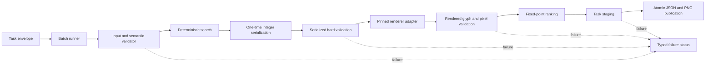

# Project Chameleon final architecture

**Status:** Gate 1 qualification is cleared and Tickets 06-08 have bounded implementation on the integrated review tree. The search enumerates all four topology families with source-derived variants, renderer-gated hard validation, fixed-point ranking, and local held-out-style evidence. The public Level 3 sample remains a typed fail-closed result; native-amd64 F-06 runtime/sample-output evidence is recorded, while cross-platform, broad organizer-held-out, and release qualification remain unverified.

**Scope:** Stage 1 retargeting engine and the separate finale integration boundary.

**Authority:** `Docs/PROJECT_CONTRACT.md` and Accepted ADR-001 through ADR-009 remain normative. The ratified schema and pinned renderer evidence follow them. This document consolidates those decisions for implementation; it does not add wire fields, change behavior, or override a contract or ADR.

## 1. Architecture goals

Project Chameleon takes one structured source design and one target canvas and returns an identity-preserving retargeted design:

```text
resize(source, target_canvas) -> target_design
```

The architecture must:

- preserve every source element, ID, order, type, content, asset reference, and immutable field;
- adapt geometry without generating, replacing, or regenerating image pixels;
- preserve exact foreground-image ratios, rigid groups, intentional overlap, and renderer-visible text bounds;
- reject hard-invalid candidates rather than returning misleading best effort;
- produce deterministic results in an offline `linux/amd64` container; and
- keep the autonomous Stage 1 engine separate from the interactive finale.

The current phase is **bounded four-topology search review after Gate 1 qualification**. Source-aware role inference, column pivot, horizontal ribbon, vertical restack, candidate variants, renderer-in-loop admission, and fixed-point ranking are implemented without changing the public schema or hard contract. The public Level 3 sample-pass criterion remains unresolved and must not be addressed by shedding records, changing copy/font attributes, substituting fonts, or relaxing hard validation. Local held-out-style evidence and native-amd64 F-06 runtime evidence are recorded separately from organizer-held-out and release qualification.

### Terminology

- **Gate 1** means renderer and validator qualification before the layout solver.
- **Level 1/2/3** means the difficulty fixtures and target-shape stress profiles.
- **Pipeline phases** are internal implementation steps; they are not product stages.
- **Stage 1** means the autonomous scored engine, while the **finale** means the separate interactive product layer.

## 2. Authority and boundaries

The decision hierarchy is:

1. `PROJECT_CONTRACT.md` and Accepted ADRs;
2. `chameleon/chameleon_design_schema_v0.9.json`;
3. the local renderer adapter and pinned `cr-renderer` commit;
4. organizer restrictions and challenge brief;
5. contract fixtures;
6. architectural guidance and implementation plans;
7. starter code and warning-only checks.

A lower-level artifact cannot silently change a higher-level decision. A durable behavioral change requires a contract update or superseding ADR.

### Stage 1 includes

- the autonomous `resize(source, target_canvas)` API;
- semantic validation and renderer conformance;
- deterministic candidate generation, hard validation, ranking, and selection;
- typed internal failure statuses;
- atomic JSON/PNG task publication; and
- the offline `linux/amd64` runtime image.

### Stage 1 excludes

- user pinning or candidate selection;
- element shedding, visibility changes, or reduced compositions;
- copy revision or font substitution;
- image regeneration, redrawing, inpainting, seam carving, or outpainting;
- runtime network access;
- a model or CP-SAT dependency in the initial implementation.

## 3. System topology



The validator is an independent oracle. Candidate generation and soft scoring are downstream of hard validation; neither may weaken or bypass it.

## 4. Public data contract

The task envelope is:

```json
{
  "source": {"canvas": {"width": 1080, "height": 1080}, "elements": []},
  "target_canvas": {"width": 1600, "height": 400}
}
```

The public success response is one flat design document:

```json
{"canvas": {"width": 1600, "height": 400}, "elements": []}
```

The source is never mutated. The response canvas equals `target_canvas` exactly. The response contains the same number of elements, in the same order, with the same unique IDs and types.

### Mutable values

Only these values may change:

- response canvas `width` and `height`;
- element `x`, `y`, `width`, and `height`; and
- text `font_size`.

Serialized mutable values are finite integers. All other source-authored values remain byte-for-byte or structurally unchanged, including:

- IDs, order, type, rotation, opacity, z-order, and `group_id`;
- text content, font family, weight, style, color, alignment, line height, letter spacing, `max_lines`, and style runs;
- image `asset_id` and `fit`; and
- shape type, fill, stroke, and corner-radius fields.

Omitted source fields remain omitted. Schema defaults are renderer defaults, not permission to add fields to the response.

## 5. Numeric and geometry architecture

### Exact numeric path

1. Parse finite JSON numbers as exact rationals for contract calculations.
2. Generate unrounded candidate geometry.
3. Apply one documented round-half-even quantization step to mutable geometry and text size.
4. Re-read the serialized integers.
5. Recompute all bounds, ratios, group relationships, overlaps, and text checks from the serialized candidate.

A candidate that passes only before serialization is invalid.

### Rotated bounds

For center `(cx, cy)`, width `w`, height `h`, and fixed rotation `theta` in degrees:

```text
a = |w cos(theta)| + |h sin(theta)|
b = |w sin(theta)| + |h cos(theta)|
AABB = [cx-a/2, cx+a/2] x [cy-b/2, cy+b/2]
```

Containment is inclusive at the target canvas boundary. The only exceptions are:

- a classified full-canvas `fit="cover"` background; and
- an ungrouped translucent source-bleed shape that was already clipped by the source canvas, retains the same clipped-side set, still intersects the target, and does not disappear.

### Images

Every positive-area foreground image preserves its source box ratio after serialization:

```text
output.width * source.height == output.height * source.width
```

The valid integer dimensions are reduced-ratio lattice points `(k*p, k*q)` for positive integer `k`. `fit="fill"` and foreground `fit="cover"` do not exempt an image from this box-ratio rule. A qualifying full-canvas background is selected deterministically by effective z-order, source rotated-envelope area, and source order.

### Groups and overlap

Elements with the same non-null `group_id` are rigid units. Every child receives the same scale `s > 0` and translation `t`:

```text
child_center' = s * child_center + t
child_width'  = s * child_width
child_height' = s * child_height
```

Text font size may change inside the transformed child box, but it cannot change the group transform or move a sibling.

Collision uses positive-area intersection of rotated AABBs:

- source-overlapping pairs may remain overlapped;
- source-separated active pairs must remain separate;
- edge and point contact are allowed; and
- zero-area records do not create positive-area collisions.

Ungrouped proximity or containment does not create a rigid group.

## 6. Renderer and typography architecture

The authoritative render path is the local converter plus `cr-renderer` commit `a17e1fb9a732959dd6c21ae168d5ee09d74bd64f`.

The adapter owns task-schema conversion, local font loading, image fit preprocessing, shape rasterization, missing-asset diagnostics, and deterministic line-map generation. The upstream renderer is not assumed to wrap text automatically.

### Text behavior

- Extended grapheme clusters are atomic units using UAX #29.
- Break opportunities follow UAX #14 and are intersected with cluster boundaries.
- Wrapping is latest-fitting greedy and preserves explicit newlines, including forced empty lines.
- Unbreakable overflow is a hard rejection.
- External style runs are 0-based, end-exclusive code-point ranges `[start, end)`.
- Empty ranges are no-ops.
- Later overlapping runs win per property supplied.
- Measurement uses the effective loaded face, serialized integer font size, span-local letter spacing, and the actual transient line map.
- `max_lines`, line-box height, and actual positioned glyph bounds are enforced after serialization.
- Content is never rewritten, reordered, hyphenated, truncated, or silently clipped.
- Rectangle and ellipse strokes rasterize inside their declared boxes without expanding public geometry.

Missing assets retain their original element records and `asset_id`. A deterministic diagnostic placeholder may be rendered for inspection, but it is never written into the design response or treated as a replacement asset.

### PNG artifact conformance

Decoded PNGs are hard-validity inputs at both candidate and publication seams,
not merely readable previews. The artifact gate mirrors the pinned renderer's
`max_size=2048` dimensions, requires an opaque canvas, checks exact
missing-asset warning provenance, rejects ink outside adapter-derived paint
regions, preserves exact opaque one-to-one image/shape raster pixels, and
compares non-exact layers against a second render from the pinned adapter.
Contrast and readability remain soft ranking concerns. Artifact failures use
`RUNTIME_IO_FAILURE`, publish no pair, and never repair or replace pixels.

## 7. Deterministic search architecture

The initial solver is a bounded structured search, not a model or CP-SAT system.

### Search stages

1. Parse and semantically validate the task.
2. Infer roles and relationships from explicit groups, image fit and coverage, z-order, opacity, element type, text measurements, geometry, source order, and source overlap.
3. Classify the contract-defined background and source-bleed decoration.
4. Generate candidates from four topology families in stable order:
   - near-isomorphic;
   - column pivot;
   - horizontal ribbon; and
   - vertical re-stack.
5. Generate at most three source-derived slot or emphasis variants per family, for a maximum of twelve initial candidates.
6. Serialize each candidate once using the numeric rules.
7. Recompute serialized geometry and apply hard structural validation.
8. Render through the pinned adapter and validate actual rendered bounds and pixels.
9. Rank only hard-valid candidates.
10. Select with fixed-point scores and stable tie-breaks.

The ranking tuple is:

```text
(hard_validity, quality_tuple, topology_order, candidate_index, source_order)
```

The quality tuple may consider readable text size, rendered contrast, hierarchy, alignment, spacing, balance, whitespace, and preservation of source-intended overlap. A soft score never rescues a hard-invalid candidate.

### Cutoffs and feasibility

A hard-valid candidate found before a deterministic cutoff may be returned after serialized validation. If no candidate has passed before the cutoff, the result is `INCOMPLETE_SEARCH`, not proven infeasibility. Only an exhausted finite search may report `INFEASIBLE_LAYOUT`.

Before reporting infeasibility, candidate generation must use all contract-permitted feasibility levers: readable font-size reduction, isotropic foreground-art scaling, topology pivots, and margin compression. It must not hide, shed, zero-size, or rewrite records.

## 8. Runner and failure architecture

The runner processes tasks independently and uses these internal statuses:

| Status | Meaning | Publication behavior |
|---|---|---|
| `SUCCESS` | A hard-valid candidate and both artifacts committed | Publish JSON and PNG as one logical pair |
| `MALFORMED_INPUT` | Envelope, schema, or semantic input is invalid | Publish neither artifact |
| `INFEASIBLE_LAYOUT` | Exhausted finite search has no hard-valid candidate | Publish neither artifact |
| `INCOMPLETE_SEARCH` | Cutoff occurred before feasibility or infeasibility was established | Publish neither artifact |
| `RUNTIME_IO_FAILURE` | Renderer, dependency, asset, serialization, or filesystem failure | Publish neither artifact |

For every task:

1. remove or quarantine stale final paths;
2. create task-private staging paths;
3. serialize and validate JSON;
4. render and validate PNG;
5. commit both final artifacts together; and
6. leave no observable one-file result on failure.

Independent tasks may continue after failure. The aggregate process exits zero only when every task commits both artifacts. No failure status is added to the public design schema, and no best-effort design is emitted on failure.

## 9. Runtime and packaging architecture

The official artifact is a single `linux/amd64` container running Python 3.11.

Build-time network access may retrieve pinned dependencies. Runtime execution uses:

```text
docker run --network none ...
```

The image contains all dependencies, renderer code, packaged fonts, and brand assets before task processing. Fonts and assets are resolved dynamically from `brand_kit/fonts` and `brand_kit/assets`; filenames and font families are never hardcoded.

The initial runtime is:

- CPU-only;
- no neural weights;
- no OR-Tools or CP-SAT dependency;
- compatible with the target amd64 environment and Apple Silicon Buildx development;
- budgeted for at most eight CPU threads and eight GB RAM; and
- targeted at less than 2.0 seconds per design and less than 500 MB solver resident memory, subject to qualification evidence.

A clean amd64 build must record dependency versions, renderer source, native-library imports, font hashes, asset resolution, PNG hashes, and no-network behavior. An arm64-only run is not Stage 1 qualification evidence.

## 10. Delivery gates

| Gate | Deliverable | Exit evidence |
|---|---|---|
| 0 | Contract and decision ratification | Contract, schema, ADR, and dependency hierarchy recorded |
| 1 | Renderer and validator qualification | Semantic hard validator, renderer edge behavior, deterministic fixtures |
| 2 | Safe geometry baseline | Integer geometry, ratios, AABBs, groups, overlap, and missing assets |
| 3 | Source-aware routing | Four topology families and role/relationship inference |
| 4 | Typography and candidate generation | Renderer-matched wrapping, font sizing, overflow rejection, strokes |
| 5 | Candidate ranking and solver choice | Hard-valid candidate reports, fixed-point scores, cutoff semantics |
| 6 | Offline submission qualification | Clean amd64 build, network isolation, pair publication, determinism |
| 7 | Finale product layer | Separate add-on integration with Stage 1 validation boundary intact |

No later gate may claim completion from a warning-only baseline check.

## 11. Finale boundary

The finale is a separate Adobe Express product layer. The add-on may communicate with the Stage 1 engine through a lightweight local HTTP service or WebAssembly module.

Finale-only interactions may include:

- candidate selection;
- user-approved spatial pinning;
- exploratory copy alternatives;
- font experiments; and
- reduced compositions.

Those outputs must be explicit finale objects. They are never silently passed through the Stage 1 wire contract. Any object labeled as a Stage 1 candidate must preserve the Stage 1 element set and pass the same semantic and rendered hard validator.

## 12. Open external facts

The architecture does not invent values for:

- hidden-task feasibility and scorer handling of missing output;
- organizer CPU, RAM, disk, GPU, or model limits;
- official scoring thresholds and complete target catalogue;
- final font and asset licensing or Adobe font availability;
- native amd64 qualification; and
- final Adobe Express deployment topology.

These facts are tracked in `Docs/STATUS.md` and `Docs/DEPENDENCY_EVIDENCE.md`. They may affect qualification or release claims but do not weaken the local Stage 1 contract.

## 13. Authoritative references

- [Project contract](PROJECT_CONTRACT.md)
- [Decision register](DECISION_REGISTER.md)
- [Accepted ADRs](DECISIONS/)
- [Ratified design schema](../chameleon/chameleon_design_schema_v0.9.json)
- [Dependency evidence](DEPENDENCY_EVIDENCE.md)
- [Implementation roadmap](IMPLEMENTATION_ROADMAP.md)
- [Implementation specification](IMPLEMENTATION/SPEC.md)
