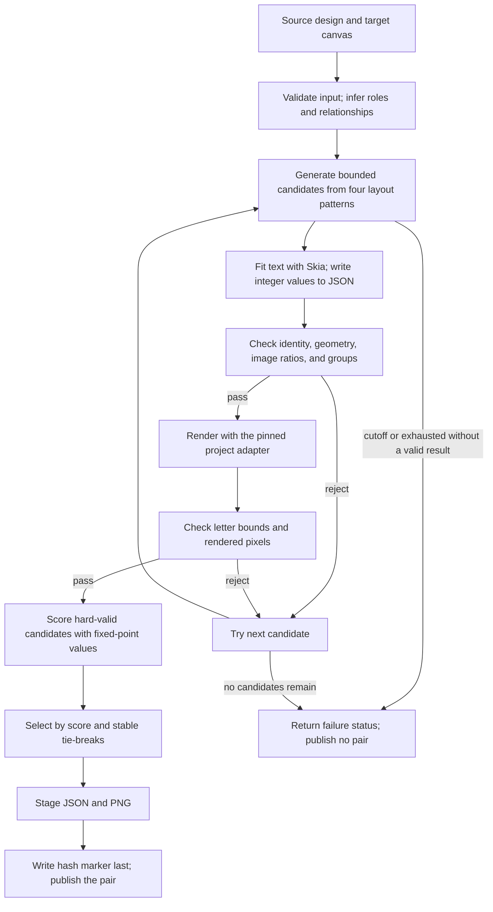

# Stage 1 engineering walkthrough

This guide supports the Adobe engineering session in Section 3.2 of the hackathon brief. Stage 1 takes a structured design and target canvas, then returns the same design records in a new layout. It has no user interface and the container runs with network access disabled. Its layout search uses no neural model, model weights, CP-SAT, or OR-Tools.

A topology is a layout pattern. A hard check is a rule every published result must pass. A quality score expresses preference; it cannot make an invalid result acceptable.

## Pipeline

The engine ranks only candidates that pass structural and renderer checks. A search cutoff without a valid candidate returns `INCOMPLETE_SEARCH`; only a completed finite search can return `INFEASIBLE_LAYOUT`. Both publish no output pair.

## Search and output rules

The engine infers roles from source fields and relationships, then searches four patterns in stable order: near-isomorphic, column pivot, horizontal ribbon, and vertical restack. It creates no more than three source-derived variants per pattern, for a cap of twelve initial candidates.

For a dense banner role profile on a canvas narrower than 350 pixels or shorter than 300 pixels, horizontal-ribbon or vertical-restack attempts can use one bounded compact-grid fallback. The 300×250 medium rectangle groups elements in two rows with two and three columns. The 160×600 narrow/tall layout uses individual full-width group rows. This is a fallback inside an existing pattern, not a fifth pattern or an increase to the twelve-candidate cap.

| Rule | What the engine checks |
| --- | --- |
| Source identity | Keep every record, ID, order, type, text, asset reference, and fixed field. Only the canvas, element geometry, and text size may change. |
| Foreground image ratio | Preserve the exact integer ratio. If the reduced source ratio is `p:q`, valid output dimensions are `(k*p, k*q)` for positive integer `k`. |
| Rigid groups | Use one shared scale and translation for group members. Round once with round-half-even, so an exact tie goes to the nearest even integer. Recheck the JSON geometry against the shared transform. |
| Text | Keep copy and fixed font fields unchanged; only `font_size` may change. Skia measures the letter shapes drawn by the effective font, line count, line height, and actual bounds. Reject clipping, overflow, and text that cannot break at an allowed Unicode boundary. |
| Assets | Keep source asset IDs and pixels. A missing asset may appear as a labeled diagnostic placeholder in the PNG with a warning; the placeholder never replaces the source reference in JSON. |
| Publication | Validate the JSON and PNG in private staging. Write the hash marker after both files. A failed task publishes no pair. |

Text wrapping never splits a visible character sequence. The engine does not hyphenate, truncate, rewrite, or reorder copy. Smaller positive font sizes may be tried when larger sizes do not fit, but there is no universal minimum font size. Readability remains a qualitative concern as well as a rendered-bounds check.

Quality scores use fixed-point arithmetic: deterministic scaled integers rather than floating-point totals. They compare only hard-valid candidates. The score includes readability, contrast, hierarchy, alignment, spacing, balance, whitespace, and source relationships. Wide-banner preferences favor a headline at least as large as the CTA and CTA labels at least as large as grouped badge labels; a headline larger than the CTA receives an extra preference. These are soft preferences, not hard size rules. The implementation does not require CTA text to be larger than supporting copy.

Fallbacks cover only the bounded candidates that the search generates. The engine does not claim coverage of every possible layout.

## Synthetic benchmark evidence

The checked-in [`scripts/generate_synthetic_cases.py`](../scripts/generate_synthetic_cases.py) creates six target formats for three source designs, for eighteen tasks. PR #84 records all eighteen as `SUCCESS`. A separate audit checked all eighteen commit markers, JSON and PNG hashes, strict response validation, PNG decoding, and target dimensions (`PAIR_VALIDATION=18/18`). The locked local test run passed 338 tests. This is local evidence, not organizer scoring or release qualification. See the [PR #84 record](https://github.com/bjornefisk/ProjectChameleon/pull/84) and [Issue #81 evidence in status](STATUS.md#issue-81-dense-17-element-synthetic-targets).

| Target format | Canvas | Width:height ratio | Tasks | Result |
| --- | ---: | ---: | ---: | --- |
| Instagram story | 1080×1920 | 9:16 | 3 | 3/3 `SUCCESS` |
| Facebook landscape | 1200×630 | 40:21, about 1.90:1 | 3 | 3/3 `SUCCESS` |
| Wide billboard | 970×250 | 97:25, 3.88:1 | 3 | 3/3 `SUCCESS` |
| Skyscraper | 160×600 | 4:15, or 1:3.75 | 3 | 3/3 `SUCCESS` |
| Medium rectangle | 300×250 | 6:5, or 1.2:1 | 3 | 3/3 `SUCCESS` |
| Compact square | 600×600 | 1:1 | 3 | 3/3 `SUCCESS` |

## Public sample timing and repeatability

A fresh local smoke of current main commit `2f1254b` returned `SUCCESS` for all three public samples. The Darwin arm64 runner reported:

| Sample | Source to target | Result | Task time |
| --- | --- | --- | ---: |
| Level 1 warmup | 1080×1080 to 1080×1350 | `SUCCESS` | 2.35 s |
| Level 2 core | 1080×1080 to 1600×400 | `SUCCESS` | 2.23 s |
| Level 3 advanced | 1080×1350 to 728×90 | `SUCCESS` | 3.01 s |

These current-main measurements exceed 1.5 seconds per task. They are local Darwin arm64 observations, not amd64 qualification or an organizer limit.

Separate native x86_64 CI runs [40228417003](https://github.com/bjornefisk/ProjectChameleon/actions/runs/40228417003), [40229964417](https://github.com/bjornefisk/ProjectChameleon/actions/runs/40229964417), and [40232041519](https://github.com/bjornefisk/ProjectChameleon/actions/runs/40232041519) ran the three public samples with networking disabled. Their repeated and clean-cache artifact hashes matched; the sample hashes were identical across the three recorded native runs. This supports repeatability for those inputs and environments. It does not establish byte identity across platforms or cover all possible designs. Official scoring, organizer-held-out evaluation, cross-platform parity, and release qualification remain unverified.

## Extreme shapes and failure handling

The 17-element Level 3 public sample, 1080×1350 to 728×90, produces a hard-valid JSON/PNG pair using the horizontal-ribbon pattern. The source records, image ratios, and group transforms remain intact. The missing `solstice_holiday_badge_2025.png` remains a warning-only placeholder in the rendered PNG; the source `asset_id` stays in JSON.

For 160×600 and 300×250, the bounded compact-grid fallback handles dense groups after the original candidates fail. The local 18-case run passed both targets and retained every record. The local visual review describes the copy as compact but visible; this is not organizer legibility evidence.

If dense copy cannot fit at an allowed Unicode break, the candidate fails. The engine does not hide overflow by cutting text or pixels. If no candidate passes before a search cutoff, the runner returns `INCOMPLETE_SEARCH`; it does not call that result infeasible and does not publish partial artifacts.

The packaged fonts are Lora/Poppins stand-ins, not confirmed final Adobe/Solstice production fonts. The engine preserves the source font family and other fixed font fields, may adjust `font_size`, and does not substitute a family. Production font identity and redistribution permission remain unverified.

## Stage 2 direction

The finale may add an Adobe Express interface with user-controlled layout locks, a choice among valid candidates, and controls that steer reflow. Copy or font experiments and reduced previews would be separate finale interactions, never Stage 1 outputs. Any result labeled Stage 1 must still pass the same hard checks.

The repository has no add-on implementation, and the final Adobe Express connection and deployment path are not settled. These are future plans, not Stage 1 capabilities.
