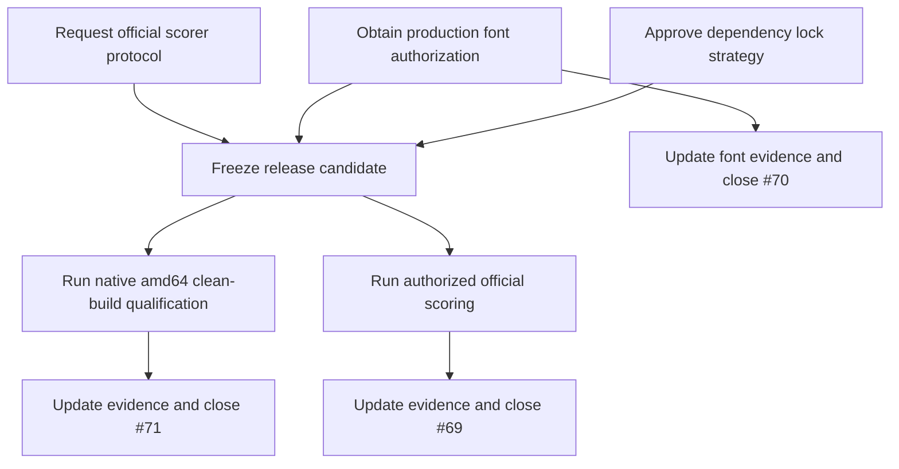

# Release blocker plan: issues #69–#71

## Purpose

Close three open release and qualification issues without weakening the Stage 1
contract or converting local smoke results into external qualification claims.
Tasks remain tracked in GitHub Issues. This file is the ordered implementation
plan and evidence boundary.

**Owner:** `@gabegaines24`

**Tracker:**

- [Issue #69 — official scoring evidence](https://github.com/bjornefisk/ProjectChameleon/issues/69)
- [Issue #70 — packaged font provenance](https://github.com/bjornefisk/ProjectChameleon/issues/70)
- [Issue #71 — clean-build dependency provenance](https://github.com/bjornefisk/ProjectChameleon/issues/71)

## PR lifecycle

Each issue gets one short-lived branch and one open pull request:

1. Branch from updated `main` with `fix/issue-<N>-<slug>`.
2. Open a draft PR immediately and keep its scope limited to issue `#N`.
3. Use `Refs #N` in the PR body while work is in progress. Do not auto-close
   the issue before acceptance evidence exists.
4. Convert the PR to ready, pass required `Verify and test`, and obtain review.
5. After acceptance evidence is recorded, close issue `#N`, then squash-merge
   its PR into `main`.
6. Confirm `main` contains the merge, then delete the feature branch.

Repository setting `delete_branch_on_merge` is enabled. Direct pushes to
protected `main` remain out of scope; required checks and review still gate
merges. No issue may have a second open PR for the same fix.

## Current baseline

- PR #73 commit `150288e` contains placeholder-font provenance evidence, a
  checked-in font/license manifest, fail-closed face validation, and regression
  tests.
- Final Adobe/Solstice production-font authorization remains unverified.
- `chameleon/Dockerfile` pins the base image, and
  `chameleon/requirements.txt` pins direct Python dependencies.
- Apt package versions and a complete hash-locked transitive wheelhouse remain
  unresolved.
- The repository has a native-amd64 CI path, but current branch evidence must
  be rerun and recorded for the candidate being qualified.
- Official scorer protocol, thresholds, target catalogue, and official results
  remain unavailable.

## Dependency graph

Requests in Phase 1 can start in parallel. Candidate qualification and official
scoring require the corresponding external approvals and a frozen revision.

## Ordered task list

Tasks live in GitHub Issues. The plan index preserves execution order:

- [ ] #69: request and record official scoring protocol or an explicit denial.
- [ ] #70: obtain production-font authorization and complete final font evidence.
- [ ] #71: approve dependency-lock strategy and complete native-amd64 build evidence.
- [ ] Checkpoint: freeze one release candidate after #70 and #71 evidence gates.
- [ ] Checkpoint: run authorized scoring for #69, or preserve its blocked state.
- [ ] Checkpoint: update `Docs/STATUS.md` and `Docs/DEPENDENCY_EVIDENCE.md`.

## Phase 1: external requests and decisions

### Task #69 — official scoring evidence

**Goal:** Replace the current external scoring blocker with authoritative,
shareable evidence, or document why evidence remains unavailable.

**Steps:**

1. Request the official evaluator protocol, thresholds, target catalogue,
   hardware constraints, and result format from the organizer.
2. Confirm whether results and protocol details may be disclosed publicly.
3. Record request date, recipient/source, response, permission, and impact in
   the issue and dependency evidence.
4. Do not request, store, or publish hidden task inputs without authorization.

**Acceptance:**

- Protocol source and revision are recorded, or the blocker has a dated denial.
- Thresholds, target coverage, hardware limits, and failure semantics are not
  inferred from local tests.
- The issue remains blocked when authoritative evidence is unavailable.

**Verification:**

- Review the source and disclosure permission.
- Confirm every reported result names the frozen commit and evaluator revision.
- Keep official scores separate from local seven-case and held-out-style results.

**Likely paths:** `Docs/STATUS.md`, `Docs/DEPENDENCY_EVIDENCE.md`,
`.agents/runs/`, and issue #69. Product code changes are not expected.

### Task #70 — production font authorization

**Goal:** Complete provenance and redistribution evidence for the exact fonts
intended for release.

**Steps:**

1. Obtain written production-font direction or authorization for every Adobe/
   Solstice face.
2. Record source URLs, immutable revisions, license terms, authorization scope,
   file hashes, embedded family/weight/style metadata, and required glyph
   coverage.
3. Replace placeholders only after authorization. Update the manifest, license
   copies, evidence record, and sample coverage tests together.
4. Run the exact offline loader, focused tests, repository verification, and
   renderer smoke path.

**Acceptance:**

- Every released font has source-backed provenance and redistribution approval.
- Exact packaged files have manifest hashes and matching embedded metadata.
- Required sample glyphs resolve through exact face lookup.
- Missing rights or glyph coverage keeps release blocked; no substitution or
  runtime download is allowed.

**Verification:**

- `python3 scripts/verify_font_provenance.py`
- `.venv/bin/python -m unittest chameleon.tests.renderer.test_font_provenance -v`
- Native qualification run after the candidate is frozen.

**Likely paths:** `chameleon/brand_kit/fonts/`,
`Docs/font_provenance_manifest.json`, `Docs/DEPENDENCY_EVIDENCE.md`,
`Docs/STATUS.md`, and focused tests.

### Task #71 — clean-build dependency provenance

**Goal:** Make release build inputs traceable and qualify one clean native
`linux/amd64` candidate without claiming more than the evidence proves.

**Steps:**

1. Freeze the candidate commit and inventory base image, apt packages, Python
   dependencies, renderer revision, native libraries, fonts, and assets.
2. Choose and document the package-lock strategy: apt snapshot/version locks,
   complete hash-locked wheelhouse, or an explicitly approved alternative.
   Record this durable choice through the required ADR/change-control path.
3. Implement only the approved dependency changes. Preserve offline runtime and
   the no-model/no-CP-SAT boundary.
4. Build with clean cache on native `linux/amd64`; capture image digest, SBOM,
   package closure, and input hashes.
5. Run `--network none` samples, failure-path publication checks, repeated
   artifacts, and clean-cache artifact comparisons.
6. Record platform, Python, renderer, image, SBOM, artifact, and exit-status
   evidence. Keep arm64-host emulation supplemental.

**Acceptance:**

- Build inputs and lock strategy are reviewed and reproducible.
- Native amd64 clean build and offline runtime pass for all three samples.
- JSON/PNG/commit-marker pairs are complete, deterministic, and fail closed.
- Remaining organizer-controlled limits stay explicitly unverified.

**Verification:**

- `make verify`
- `make test` in the required Python 3.11 environment.
- The exact CI Buildx, SBOM, native runtime, clean-cache, and repeated-hash
  workflow in `.github/workflows/ci.yml`.
- Review `.agents/runs/` evidence before closing the issue.

**Likely paths:** `chameleon/Dockerfile`, `chameleon/requirements.txt`,
`.github/workflows/ci.yml`, `Docs/DEPENDENCY_EVIDENCE.md`, `Docs/STATUS.md`,
`.agents/runs/`, and an ADR if the lock strategy changes.

## Phase 2: candidate checkpoint

Do not run official scoring against a moving branch. Freeze one candidate after
font authorization and dependency qualification evidence is complete.

Checkpoint acceptance:

- The candidate commit, image digest, source inputs, and evidence revisions are
  recorded.
- No unresolved release blocker is hidden by a warning-only or emulated run.
- Local hard validation, native qualification, and official scoring remain
  separate evidence classes.

## Phase 3: scoring and closure

1. If the organizer authorizes scoring, run the frozen candidate through the
   official process and record results for Levels 1, 2, and 3.
2. Record score, threshold, hard-valid rate, failure statuses, runtime, tested
   commit, evaluator revision, and disclosure permission.
3. If authorization or results remain unavailable, update #69 with the dated
   request and impact, retain `UNVERIFIED_EXTERNAL_FACT`, and do not close it.
4. Close #69, #70, or #71 only after each issue's acceptance evidence is linked.
5. Update status and dependency evidence with observed results and explicit
   unrun checks.

## Risks and mitigations

| Risk | Impact | Mitigation |
| --- | --- | --- |
| Organizer does not disclose scorer details | Official qualification remains blocked | Record request, denial, date, and impact; preserve blocked state |
| Production font rights differ from placeholders | Release may be unauthorized | Require written authorization before replacing or shipping faces |
| Apt or transitive wheel resolution changes | Clean builds are not reproducible | Approve and record a lock strategy before dependency edits |
| Native amd64 capacity is unavailable | Platform evidence remains incomplete | Use CI/native capacity; label arm64 emulation supplemental |
| Hidden inputs or results are confidential | Public issue could leak protected data | Record only authorized metadata and shareable results |
| Candidate changes during evaluation | Results cannot bind to release | Freeze commit and record all revisions before running |

## Out of scope

- Model, model weights, CP-SAT, OR-Tools, or new solver scope.
- Finale/add-on work, user pinning, copy revision, font substitution, or image
  regeneration.
- Invented scoring thresholds, organizer limits, or hidden-task assumptions.
- Closing issues using local smoke output alone.
